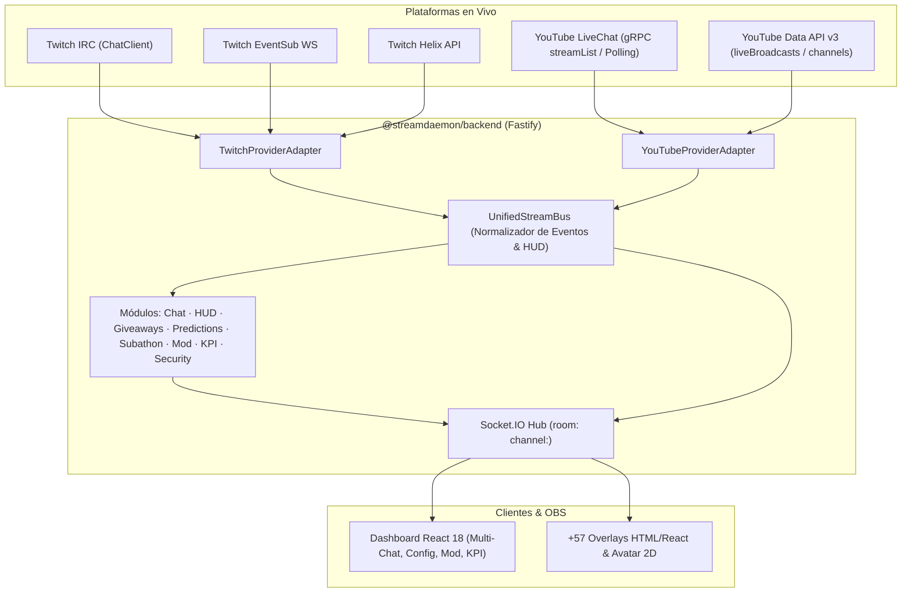

# 📺 Documento Maestro de Ingeniería: Integración Total con YouTube Live (Single & Multistream)

> **Proyecto:** StreamDaemon (StreamForge)  
> **Estado:** Documento Maestro de Arquitectura y Hoja de Ruta  
> **Objetivo:** Hacer que el 100% de las funciones de StreamDaemon (los +57 Overlays, HUD, Chat, Alertas, Sorteos, Predicciones, Subathon, Avatar 2D en Directo, Moderación, Seguridad Anti-Bots y KPIs) sean totalmente compatibles con emisiones en directo de **YouTube Live**, tanto en modo exclusivo (**Solo YouTube**) como en modo simultáneo (**Multistream Twitch + YouTube**).

---

## 1. Principios de Diseño y "Zero-Breakage"

1. **Compatibilidad Instantánea con los +57 Overlays (`Zero-Breakage`):**
   - Los overlays actuales en `packages/frontend/public/overlays/*.html` y los overlays React escuchan eventos de Socket.IO en la sala `channel:${channel}` (`chat:message`, `hud:update`, `channel:follow`, `channel:subscribe`, `channel:subscription-message`, `channel:subgift`, `channel:cheer`, `channel:raid`, `channel:redemption`).
   - **Regla de Oro:** YouTube **no** emitirá eventos con nombres distintos hacia los overlays. En su lugar, un **Bus Unificado de Eventos (`UnifiedStreamBus`)** en el backend traducirá los eventos de YouTube Live a los mismos contratos de `@streamdaemon/shared`, añadiendo la propiedad opcional `platform: 'twitch' | 'youtube'`. Así, los 57+ overlays funcionarán con YouTube desde el minuto uno sin romper ni duplicar archivos HTML.

2. **Soporte Nativo para 3 Modos de Emisión:**
   - **🟣 Modo Twitch:** Comportamiento actual intacto.
   - **🔴 Modo YouTube Live:** El usuario inicia sesión únicamente con su cuenta de Google/YouTube. El identificador de canal (`channel`) usa su handle de YouTube (ej. `mi_canal`) o ID de canal.
   - **⚡ Modo Multistream (Twitch + YouTube simultáneo):** Ambas cuentas conectadas al mismo perfil local. El Chat del Dashboard muestra mensajes combinados con insignia de origen (`[TW]` / `[YT]`), las alertas entran en una única cola ordenada, los sorteos aceptan participantes de ambos chats y el HUD puede mostrar métricas agregadas o por plataforma.

3. **Local-First & Privacidad Absoluta:**
   - Tokens OAuth2 de Google cifrados en reposo con **AES-256-GCM** (`packages/backend/src/auth/token-crypto.ts`) en la base de datos SQLite local (`streamforger.db` en modo WAL).

---

## 2. Arquitectura del Sistema Multi-Plataforma



---

## 3. Matriz de Equivalencia Funcional (Twitch ↔ YouTube Live)

Para que todos los paneles, alertas, sonidos, avatares y el Subathon respondan de forma idéntica en YouTube, se define el siguiente mapeo canónico en `@streamdaemon/shared`:

| Evento Socket.IO (`@streamdaemon/shared`) | Origen en Twitch | Origen en YouTube Live | Normalización de Payload |
| :--- | :--- | :--- | :--- |
| **`chat:message`** | IRC `onMessage` | `liveChatMessages` (`textMessageEvent`) | `platform: 'youtube'`, `user.badges` mapeado desde `isChatOwner` (`broadcaster`), `isChatModerator` (`moderator`), `isChatSponsor` (`subscriber`), `isVerified` (`vip`). |
| **`channel:follow`** | EventSub `channel.follow` | Suscripción gratuita al canal de YouTube | Detectado vía `subscriptions.list(myRecentSubscribers=true)` (si el suscriptor tiene suscripciones públicas) + incremento en `statistics.subscriberCount`. |
| **`channel:subscribe`** | EventSub `channel.subscription` | `liveChatMessages` (`newSponsorEvent`) | Nuevo **Miembro del Canal** (Unirse). Nivel (`memberLevelName`) mapeado a `tier` (`'1000'` / nombre del nivel). |
| **`channel:subscription-message`** | EventSub `channel.subscription.message` | `liveChatMessages` (`memberMilestoneChatEvent`) | Renovación / Hito de Membresía. `memberMonth` → `cumulativeMonths`, `userComment` → `messageText`. |
| **`channel:subgift`** | EventSub `channel.subscription.gift` | `liveChatMessages` (`membershipGiftingEvent`) | Regalo de Membresías de YouTube (`giftMembershipsCount` → `amount`, `giftMembershipsLevelName` → `tier`). |
| **`channel:cheer`** | EventSub `channel.cheer` (Bits) | `liveChatMessages` (`superChatEvent` / `superStickerEvent`) | **Super Chat & Super Stickers**. Se incluye `formattedAmount` (ej. `"5,00 €"`) y se convierte `amountMicros` a `bits` equivalentes (ej. `1 unidad monetaria = 100 pts`) para alimentar el **Subathon** y las alertas de Bits. |
| **`channel:raid`** | EventSub `channel.raid` | Redirección en vivo de YouTube / Evento manual | Soporte para disparo desde API/Dashboard y detección de mensajes de sistema de redirección. |
| **`channel:redemption`** | EventSub `channel.redemption.add` | Super Stickers / Comandos con Cooldown | En YouTube (que no tiene Channel Points en su API), los Super Stickers o comandos especiales pueden disparar las mismas acciones de canje/sorteo. |
| **`hud:update`** | Helix `streams`, `channels`, `subscriptions` | `liveBroadcasts.list` + `videos.list(liveStreamingDetails)` + `channels.list(statistics)` | `viewers` = `concurrentViewers`, `followers` = `subscriberCount`, `subscribers` = miembros activos, `uptimeSeconds` = `now - actualStartTime`, `streamTitle` = `snippet.title`. |

---

## 4. Estrategia Crítica de Cuota de YouTube Data API v3

> [!WARNING]
> **El problema de la cuota en YouTube Data API v3:**  
> Google asigna por defecto **10.000 unidades de cuota al día** por proyecto en Google Cloud.  
> - `liveChatMessages.list` cuesta **5 unidades** por llamada. Si se hace polling cada 2 segundos, consume $1.800 \times 5 = 9.000$ unidades en **1 sola hora**, agotando la cuota diaria a mitad del directo.
> - `search.list` cuesta **100 unidades** por llamada (prohibido usarlo para buscar el directo activo).

### Solución de Ingeniería en 3 Capas para StreamDaemon

1. **Prohibición de `search.list` — Descubrimiento de Directo por 1 Unidad:**
   - Para localizar la emisión activa y su `liveChatId`, se utilizará **exclusivamente** `liveBroadcasts.list(part='snippet,contentDetails,status', broadcastStatus='active')`, cuyo coste es de **1 sola unidad** al inicio del directo.
2. **Ingesta de Chat mediante Streaming Push (`liveChatMessages.streamList`) + Polling Adaptativo:**
   - **Vía Primaria (Baja Latencia):** Uso del endpoint de streaming `liveChatMessages.streamList` (Server-Sent / gRPC stream de YouTube Data API v3) que mantiene una conexión abierta recibiendo mensajes en tiempo real sin disparar peticiones cada 2 segundos.
   - **Vía Secundaria (Polling Inteligente):** Si el stream se corta, el poller usa `liveChatMessages.list` respetando estrictamente el `pollingIntervalMillis` devuelto por Google, **pausándose automáticamente** cuando `isLive === false` y aumentando el intervalo si el chat está inactivo.
3. **Arquitectura Híbrida de Credenciales (OAuth + BYOK + Conector Local Zero-Quota):**
   - **Modo OAuth Estándar + BYOK (Bring Your Own Key):** En `ConfigPanel`, el usuario puede usar las credenciales integradas o pegar su propio `YOUTUBE_CLIENT_ID` / `YOUTUBE_CLIENT_SECRET` de Google Cloud Console para disponer de sus propias **10.000 unidades/día exclusivas**.
   - **Modo Lectura Sin Cuota (Zero-Quota Live Reader opcional):** Para lectura de chat y espectadores concurrentes sin consumir cuota de Data API v3, un adaptador opcional basado en parser local de sesión en vivo (Innertube) permite leer mensajes, Super Chats y miembros con **0 consumo de cuota API**, reservando la cuota oficial de Data API v3 únicamente para acciones de escritura (enviar mensajes del bot, banear/timeout, cambiar título del stream).

---

## 5. Cambios Detallados por Paquete del Monorepo

### Fase 1: Contratos Compartidos (`packages/shared`)
Archivos a modificar:
- `packages/shared/src/types.ts`
- `packages/shared/src/schemas.ts`
- `packages/shared/src/constants.ts`

**Especificación de Tipos:**
```ts
export type StreamPlatform = 'twitch' | 'youtube';

export interface PlatformUser {
  platform: StreamPlatform;
  id: string;
  login: string;        // En YouTube: handle sin '@' (ej. 'auronplay') o channelId
  displayName: string;
  avatarUrl: string | null;
  liveBroadcastId?: string | null;
  liveChatId?: string | null;
}

export interface AuthStatusResponse {
  authenticated: boolean;
  primaryPlatform: StreamPlatform | null;
  activeMode: 'twitch' | 'youtube' | 'multi';
  accounts: {
    twitch: PlatformUser | null;
    youtube: PlatformUser | null;
  };
}
```
- Añadir `platform?: StreamPlatform` a `ChatMessage`, `ChannelFollowEvent`, `ChannelSubscribeEvent`, `ChannelSubscriptionMessageEvent`, `ChannelSubGiftEvent`, `ChannelCheerEvent`, `ChannelRedemptionEvent`, y `HudData`.
- Añadir en `ChannelCheerEvent`:
  - `formattedAmount?: string` (ej. `"5,00 €"` para Super Chats de YouTube, manteniendo `bits: number` como valor numérico normalizado).
  - `tierColor?: string` (color oficial del nivel de Super Chat de YouTube: azul, cian, verde, amarillo, naranja, magenta, rojo).

---

### Fase 2: Esquema de Base de Datos y Autenticación OAuth2 (`packages/desktop` & `packages/backend/src/auth`)
Archivos a modificar/crear:
- `packages/desktop/prisma/schema.prisma`
- `packages/backend/src/auth/index.ts`
- `packages/backend/src/auth/youtube-auth.ts` *(nuevo)*
- `packages/backend/src/config.ts`

**1. Evolución de `schema.prisma` (100% Retrocompatible):**
Añadiremos el modelo `PlatformAccount` para almacenar las credenciales cifradas de YouTube (y Twitch) sin romper las relaciones actuales de `User`:
```prisma
model PlatformAccount {
  id             String    @id @default(cuid())
  userId         String
  user           User      @relation(fields: [userId], references: [id], onDelete: Cascade)
  platform       String    // "twitch" | "youtube"
  platformUserId String    // Twitch User ID o YouTube Channel ID (UC...)
  login          String    // Twitch login o YouTube customUrl/handle
  displayName    String
  avatarUrl      String?
  accessToken    String    // Cifrado con AES-256-GCM
  refreshToken   String    // Cifrado con AES-256-GCM
  tokenExpiresAt DateTime?
  scopes         String?   // Scopes concedidos separados por espacio
  metadata       String?   @default("{}") // liveBroadcastId, liveChatId, quotaUsed, etc.
  createdAt      DateTime  @default(now())
  updatedAt      DateTime  @updatedAt

  @@unique([platform, platformUserId])
  @@index([userId, platform])
}
```
*(Si el usuario entra solo con YouTube sin tener cuenta de Twitch, se crea un registro `User` raíz con `twitchId = "yt:<channelId>"` para que todas las tablas existentes `ChannelConfig`, `Giveaway`, `Prediction`, `SecurityConfig`, `StreamSession` y `GameStat` funcionen sin cambiar sus claves foráneas).*

**2. Flujo OAuth 2.0 de Google/YouTube para Desktop y Web (`youtube-auth.ts`):**
- **Scopes solicitados:**
  - `https://www.googleapis.com/auth/youtube.readonly` (leer canal, directos, suscriptores)
  - `https://www.googleapis.com/auth/youtube` (moderar, gestionar broadcast, enviar chat)
  - `https://www.googleapis.com/auth/youtube.force-ssl` (requerido por `liveChatMessages` y `liveChatBans`)
- **Endpoints en Fastify:**
  - `POST /auth/youtube/start`: Genera la URL de autorización OAuth2 con PKCE apuntando al callback local `http://127.0.0.1:3000/auth/youtube/callback` (o flujo Device Code para clientes tipo TV/Desktop).
  - `GET /auth/youtube/callback`: Intercambia el `code` por `access_token` y `refresh_token`, consulta `channels.list(part='snippet,statistics', mine=true)`, cifra los tokens con `encryptToken()` (AES-256-GCM) y cierra la ventana emergente notificando a la app mediante `auth:changed`.
  - `POST /auth/youtube/logout`: Desconecta únicamente la cuenta de YouTube (o cierra sesión global si era la única plataforma conectada).
  - Refresh automático de `access_token` antes de su expiración (3600s) usando `refresh_token`.

---

### Fase 3: Motor YouTube Live en Backend (`packages/backend/src/youtube/`)
Crearemos un nuevo módulo modularizado en `packages/backend/src/youtube/`:
- `packages/backend/src/youtube/client.ts`: Cliente ligero HTTP/REST + Streaming sobre `fetch` nativo de Node (sin dependencias pesadas como `googleapis` completo que pesan >100 MB en el instalador de Electron), con control de cuota diario en memoria/SQLite.
- `packages/backend/src/youtube/live-chat.ts`:
  - Resolución automática del `activeLiveChatId` cuando hay emisión en curso.
  - Lector en tiempo real de `liveChatMessages`:
    - `textMessageEvent` → emite `chat:message`, ejecuta `handleCommands` (`!sorteo`, `!votar`, comandos personalizados), pasa por `checkMessage` (filtro anti-spam) y suma a `incrementChatCounter` (KPIs).
    - `superChatEvent` & `superStickerEvent` → emite `channel:cheer`, registra en `recordEvent` (`activity`), y suma tiempo al `subathon`.
    - `newSponsorEvent` → emite `channel:subscribe`, registra en `recordEvent` y suma al `subathon`.
    - `memberMilestoneChatEvent` → emite `channel:subscription-message`, registra en `recordEvent` y suma al `subathon`.
    - `membershipGiftingEvent` → emite `channel:subgift`, registra en `recordEvent` y suma al `subathon`.
  - Envío de mensajes al chat de YouTube (`liveChatMessages.insert`) para:
    - Respuestas de comandos personalizados (`!redes`, `!pc`, etc.).
    - Temporizadores de chat (`chat-timers`).
    - Auto-saludo (`chat-greeting`).
    - Anuncio de ganadores de sorteos (`giveaways`).
- `packages/backend/src/youtube/poller.ts`:
  - Sincronización de estado del stream (`stream.online` / `stream.offline` para iniciar y cerrar `StreamSession` en `kpi/session.ts`).
  - Detección de nuevos suscriptores públicos del canal (`subscriptions.list(myRecentSubscribers=true)`) para disparar `channel:follow`.

---

### Fase 4: Adaptación de Módulos del Backend (`hud`, `mod`, `predictions`, `security`, `kpi`, `index.ts`)
1. **`packages/backend/src/hud/index.ts`:**
   - Si el canal activo es YouTube, `fetchHud()` obtiene los datos de `videos.list(part='snippet,liveStreamingDetails', id=broadcastId)` y `channels.list(part='statistics')`.
   - Si está en **Modo Multistream (Twitch + YouTube)**:
     - `viewers = twitchViewers + youtubeViewers` (con desglose opcional `platformBreakdown: { twitch, youtube }`).
     - `PUT /hud/stream/info`: Actualiza simultáneamente el título del directo en Twitch (`api.channels.updateChannelInfo`) y en YouTube (`liveBroadcasts.update`).
2. **`packages/backend/src/mod/index.ts`:**
   - Añadir soporte multi-plataforma a `/mod/timeout`, `/mod/ban` y `/mod/unban`:
     - En YouTube ejecuta `liveChatBans.insert` (`type: 'temporary'` con `banDurationSeconds` para timeout, o `type: 'permanent'` para ban) y `liveChatBans.delete` para unban.
3. **`packages/backend/src/predictions/index.ts`:**
   - En Twitch sigue sincronizando con la API de Predicciones de Twitch si está disponible, pero añade un **Motor Local de Votación por Chat (`!votar 1`, `!votar 2`)** para que en YouTube Live (y canales de Twitch sin afiliado) las predicciones funcionen al 100% en el Dashboard y en el overlay de predicciones.
4. **`packages/backend/src/security/index.ts`:**
   - Aplicar los filtros de spam y auto-ban de mensajes también sobre el chat entrante de YouTube, ejecutando `liveChatBans.insert` cuando un bot o spammer supere el umbral.
5. **`packages/backend/src/index.ts` (CSP Headers):**
   - Actualizar la cabecera `Content-Security-Policy` para permitir dominios oficiales de Google/YouTube:
     - `connect-src`: añadir `https://www.googleapis.com https://oauth2.googleapis.com https://accounts.google.com`
     - `img-src`: añadir `https://*.ggpht.com https://*.googleusercontent.com https://i.ytimg.com`
     - `frame-src`: añadir `https://www.youtube.com`

---

### Fase 5: Interfaz de Usuario en Frontend (`packages/frontend`)
1. **Pantalla de Inicio de Sesión y `ConfigPanel.tsx`:**
   - Permitir iniciar sesión con **Twitch**, con **YouTube** o **conectar ambas cuentas** en la sección de Cuentas Conectadas.
   - Indicador visual del estado de ambas conexiones, selector de plataforma principal y panel opcional de **Credenciales Google Cloud (BYOK)** + medidor de cuota diaria estimada de YouTube API.
2. **`ChatPanel.tsx` (Chat Unificado Virtualizado):**
   - Mostrar insignia de plataforma (`🟣 Twitch` / `🔴 YouTube`) junto a cada mensaje cuando ambas plataformas estén activas.
   - Resaltado visual para **Super Chats** (con su color oficial de nivel e importe) y **Nuevos Miembros**.
   - Selector al enviar un mensaje desde el Dashboard: enviar a `Ambos`, `Solo Twitch` o `Solo YouTube`.
3. **`HudPanel.tsx` & `StreamDashboard.tsx`:**
   - Mostrar espectadores en vivo desglosados o combinados (`Twitch + YouTube`) y permitir editar el título del directo en ambas plataformas a la vez.
4. **`ObsPanel.tsx` y Overlays (`public/overlays/`):**
   - Las URLs generadas siguen usando `?channel=<canal>` y funcionan transparentemente con Twitch, YouTube o Multistream.
   - En los overlays que muestran etiquetas semánticas (ej. `Followers` / `Subs` / `Bits`), soportar adaptación automática o etiqueta universal cuando el evento lleva `platform: 'youtube'` (ej. mostrar el importe real `"5,00 €"` en las alertas de Super Chat cuando venga `formattedAmount`).

---

## 6. Plan de Ejecución Paso a Paso (Roadmap de Implementación)

| Fase | Entregable | Paquetes Afectados | Validación |
| :---: | :--- | :--- | :--- |
| **Fase 1** | Contratos `StreamPlatform`, `PlatformUser`, extensión de eventos Socket.IO y esquemas Zod. | `packages/shared` | `npm run build -w packages/shared` |
| **Fase 2** | Modelo `PlatformAccount` en Prisma + Flujo OAuth 2.0 de YouTube con cifrado AES-256-GCM y refresh automático. | `packages/desktop`, `packages/backend/src/auth` | Login/Logout en Twitch, YouTube y Dual-Login. |
| **Fase 3** | Cliente ligero YouTube Data API v3 (`youtube/client.ts`, `live-chat.ts`, `poller.ts`) + Bus Unificado de Eventos (`UnifiedStreamBus`). | `packages/backend/src/youtube` | Recepción de chat, Super Chats, Miembros y Suscriptores en vivo + Modo Simulador YouTube. |
| **Fase 4** | Adaptación de `hud`, `mod`, `predictions` (votos por chat `!votar`), `giveaways`, `subathon`, `security` y `kpi`. | `packages/backend` | Comandos, sorteos, predicciones y moderación funcionando en YouTube. |
| **Fase 5** | UI en Dashboard: Login Dual Twitch/YouTube, `ConfigPanel`, insignias e importe de Super Chat en `ChatPanel`, `HudPanel` y `ModPanel`. | `packages/frontend` | `npm run typecheck` y `npm run lint` con 0 errores. |
| **Fase 6** | Mejoras en Overlays (soporte visual de `formattedAmount` para Super Chats e icono de plataforma opcional) + Herramienta de Simulación de Eventos de YouTube. | `packages/frontend/public/overlays` | Prueba extremo a extremo en OBS Browser Source. |

---

## 7. Decisiones Clave de Diseño Acordadas

1. **Sin dependencias pesadas en Electron:** No instalaremos el paquete monolítico `googleapis` (que añade >120 MB de definiciones de todas las APIs de Google). Implementaremos un cliente tipado específico para **YouTube Data API v3** usando `fetch` nativo de Node 20+ y validación Zod.
2. **Simulador Integrado de Eventos de YouTube:** Dado que probar Super Chats, Regalos de Membresías o Hitos en directo real en YouTube es complejo sin estar emitiendo, incluiremos un endpoint local de prueba (`POST /youtube/simulate-event`) accesible desde el Dashboard para disparar Super Chats, Nuevos Miembros, Suscriptores y Mensajes de Chat de YouTube en cualquier momento y verificar todos los overlays en OBS.

